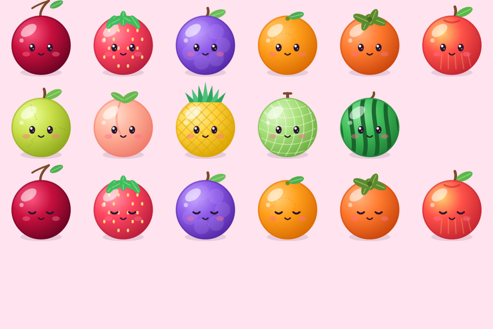

# Fruit Pop Merge

An original drop-and-merge physics puzzle game for Android, built with Expo (TypeScript, dev build),
Skia, matter-js and Reanimated.



## Setup

Requirements: Node 20+, JDK 17+ (21 works), Android SDK (Android Studio or command-line tools), an
Android phone with USB debugging **or** an emulator, and the EAS CLI for cloud builds (`npm i -g eas-cli`).

```bash
npm install
```

```bash
npm run sounds        # (re)generate the synthesized sound effects + music in assets/sounds
```

### Run a development build on a device/emulator

This app uses native modules (Skia, MMKV, AdMob, Reanimated), so **Expo Go will not work**. Either:

Local build (needs the Android SDK; `ANDROID_HOME` set):

```bash
npx expo run:android
```

Or a cloud dev build, then install the APK it gives you:

```bash
eas build --platform android --profile development
```

After the dev build is installed, start the JS server:

```bash
npm start
```

`npx expo prebuild` is only needed if you want to look at / edit the generated `android/` folder. It is
git-ignored and regenerated from `app.config.ts` (Continuous Native Generation) — never hand-edit it.

### Checks

```bash
npm test              # Jest: merge chain, scoring, seeded RNG, combo timer, interstitial pacing, engine
npm run typecheck
npm run preview       # renders fruit art + simulated gameplay frames to docs/preview/*.png (no phone needed)
```

## Project layout

```
App.tsx                  screen switch (menu / game / collection / settings) + startup (audio, ads)
app.config.ts            Expo config, reads src/config/app.json
src/config/app.json      app title, package id, version, AdMob APP ids, privacy URL  <- one place
src/config/ads.ts        ad UNIT ids (test by default), pacing rules
src/config/theme.ts      UI + background colors
src/game/                pure TS, no React: engine (matter-js), fruits, spawner, scoring/combo, rng, effects pools
src/render/              Skia: fruitArt (procedural fruit pictures), drawFrame (whole scene), GameCanvas (loop + gestures), perf
src/ui/                  screens + components
src/audio/               expo-audio SFX/music, expo-haptics
src/ads/                 AdMob + UMP consent, menu banner
src/storage/             MMKV wrapper (best, daily best, merges, collection, settings)
src/iap/                 "Remove Ads" purchase stub (TODOs)
scripts/                 generate-sounds.js, preview renderer
__tests__/               Jest tests
```

### Architecture notes

- **Game loop.** `GameCanvas` runs a `requestAnimationFrame` loop on the JS thread. Physics steps on a
  fixed 60 Hz accumulator (2 sub-steps per tick, max 4 ticks per frame, velocity cap of 20 units/step,
  80-unit-thick walls → no tunneling). Then `drawFrame` records the whole scene into **one SkPicture**
  and assigns it to a Reanimated shared value; Skia redraws on the UI thread. React does not re-render
  during play (HUD only re-renders when the score / next fruit changes).
  - Why not `useFrameCallback`? Its callback is a UI-thread worklet, and matter-js can't run in the
    worklet runtime. Running physics on JS and shipping one picture per frame is the cheapest bridge.
- **No per-frame allocations** for effects: particles (160), rings, popups and merge "ghosts" are
  pre-allocated pools in `src/game/effects.ts`. Paints are created once. Each fruit is drawn
  procedurally once and cached as an SkPicture (`fruitArt.ts`), so a fruit costs one `drawPicture`.
- **Determinism.** The drop sequence comes from a seeded PRNG (`mulberry32`). Daily challenge seed =
  hash of the local date, so everyone gets the same fruits that day. Cosmetic randomness uses a
  separate RNG and never shifts the sequence.

## Changing the theme and fruits

- **Colors / background:** `src/config/theme.ts` (`bgA`/`bgB` are the two gradient palettes the
  background drifts between).
- **Fruits:** `src/game/fruits.ts`. Each entry has `name`, `radius` (world units; the jar is 400 wide),
  `score`, and four colors. Add/remove entries freely — the chain length, collection screen,
  merge sounds (clamped) and vanish rule all follow `FRUITS.length`. Spawnable levels: `SPAWN_LEVELS`
  and `SPAWN_WEIGHTS` in `spawner.ts`.
- **Fruit look:** `src/render/fruitArt.ts` — `details()` (patterns) and `crown()` (stems/leaves) switch on
  the fruit name; anything without a case is a plain glossy ball with a face. Run `npm run preview`
  to see the result as a PNG.
- **Feel:** gravity / friction / bounce in `engine.ts` (`addFruit`, `matter.gravity.y`), combo window
  and multiplier cap in `scoring.ts`, game-over timing (`GAME_OVER_MS`, `WARN_MS`) in `engine.ts`.
- **Sounds:** replace any file in `assets/sounds/` with a same-named royalty-free file, or tweak
  `scripts/generate-sounds.js` and run `npm run sounds`.
- **Title / package:** `src/config/app.json`.

## Swapping ad IDs (before release)

1. Create an app in [AdMob](https://apps.admob.com) and put the **App ID** (`ca-app-pub-…~…`) in
   `src/config/app.json` → `admobAndroidAppId`.
2. Create three ad units (Banner, Interstitial, Rewarded) and paste their IDs into `PRODUCTION` in
   `src/config/ads.ts`.
3. In the same file set `USE_TEST_ADS = __DEV__` so dev builds keep using test ads.
4. Rebuild (app ID changes are native config → new build required, not an OTA update).
5. Never tap your own live ads. Add your phone as a test device in AdMob.

Pacing (in `src/config/ads.ts`): interstitial on every 3rd game over, never in the first 2 games, never
during play; rewarded "Continue" once per run; rewarded power-ups max 2 per run; banner on the menu only.
Consent: Google UMP (`AdsConsent.gatherConsent`) runs before the SDK initializes; Settings shows a
"Privacy options" button when UMP says it is required. Child-directed tagging is `false`.

## Profiling

In dev builds `src/render/perf.ts` logs every 5 s to Metro (or logcat `ReactNativeJS` in a release build made with `EXPO_PUBLIC_PERF=1`):
`[perf] { fps, p95FrameMs, jank, avgJsWorkMs, p95JsWorkMs }`. `avgJsWorkMs` is physics + scene
recording per frame; it must stay well under ~10 ms on your target phone for 60 fps.
For deeper checks: Android Studio → Profiler (CPU/memory), or `adb shell dumpsys gfxinfo
com.fruitpopmerge.game` for frame stats. Measure a **release** build (`--profile preview`) — dev
builds are several times slower.

Caps for low-end phones: 160 particles, 90 fruits max, 16 particles per merge, backlog of physics
steps dropped instead of spiraling. Lower `maxParticles` in `GameEngine` options if needed.

## Edge cases handled

- Fast swipes: aim is clamped inside the jar every update; drop uses the release position.
- Drop spam: 480 ms cooldown; drops are ignored while a bomb is armed, paused or game over.
- Rotation: locked to portrait in `app.config.ts`.
- Backgrounding: `AppState` auto-pauses the run and music; Android back button toggles pause.
- Long frames (e.g. after a GC or notification shade): physics catches up at most 4 steps, then drops the
  backlog, so fruits never teleport through each other.
